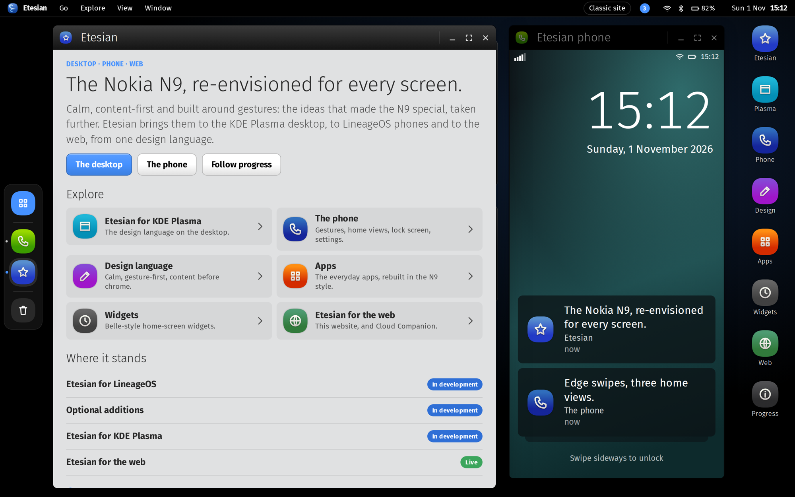
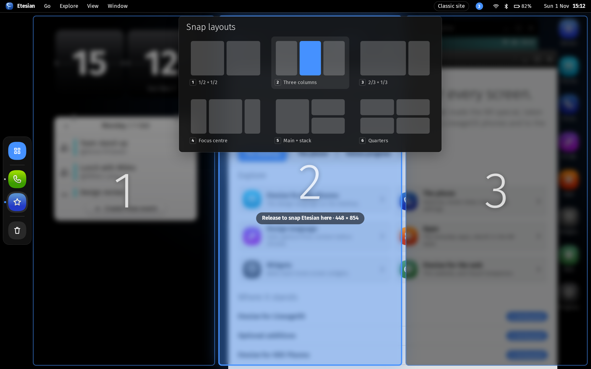
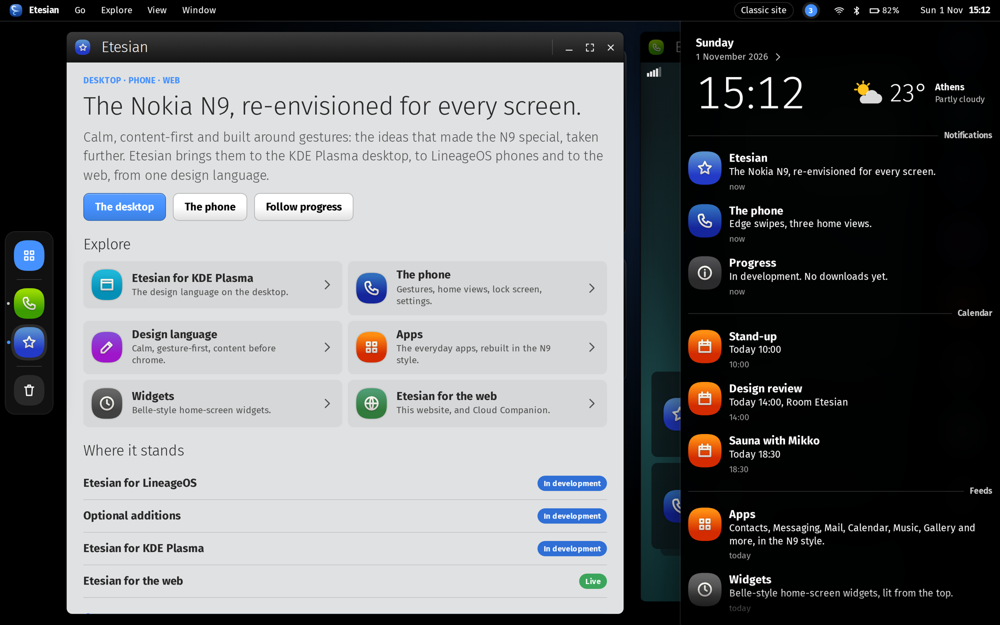

<p align="center">
  
</p>

<h1 align="center">etesian-design.com</h1>

<p align="center">
  <b>Etesian, in your browser.</b> A working desktop with windows you can drag, snap and resize, and a phone you can
  swipe through, or the same content as a plain page.
</p>

<p align="center">
  <a href="https://etesian-design.com">Visit the site</a> ·
  <a href="https://language.etesian-design.com">Design language</a> ·
  <a href="https://github.com/etesian-design/android_vendor_etesian">Phone</a> ·
  <a href="https://github.com/etesian-design/plasma">KDE Plasma</a>
</p>

---

This repository is the source of etesian-design.com, the website of Etesian: a cross-platform design language that
re-envisions the Nokia N9's Swipe UI for today.

<table>
  <tr>
    <td></td>
    <td></td>
  </tr>
  <tr>
    <td align="center">Drag a window to the top to snap it</td>
    <td align="center">Events, a click on the menu bar away</td>
  </tr>
</table>

Built with Vue 3 and Quasar on the [design repo](https://github.com/etesian-design/design)'s own packages
(`@etesian-design/tokens`, `vue`, `quasar` and `shell`), so the site is the design system in use.

## Run it

The packages are on GitHub Packages, which asks for a GitHub token even to install public packages. Once, put a
[classic token](https://github.com/settings/tokens) with `read:packages` in your `~/.npmrc`:

```sh
echo "//npm.pkg.github.com/:_authToken=YOUR_TOKEN" >> ~/.npmrc
```

Then:

```sh
git clone https://github.com/etesian-design/website etesian-website
cd etesian-website && npm ci && npm run dev    # http://localhost:6120
```

| Command | What it does |
|---|---|
| `npm run build` | Pre-renders every page into `dist/ssg` |
| `npm run screenshots` | With the dev server running: checks every view and saves screenshots |

**Editing the text?** It's all JSON in `src/content`, no code needed. See [CONTENT.md](CONTENT.md).

Every push to `main` builds the site and publishes it to GitHub Pages.

## Related projects

The [design language](https://github.com/etesian-design/design), the
[phone](https://github.com/etesian-design/android_vendor_etesian) (any LineageOS phone) and
[KDE Plasma](https://github.com/etesian-design/plasma).

## Licence

MIT. Etesian is an independent project and isn't affiliated with Nokia.
